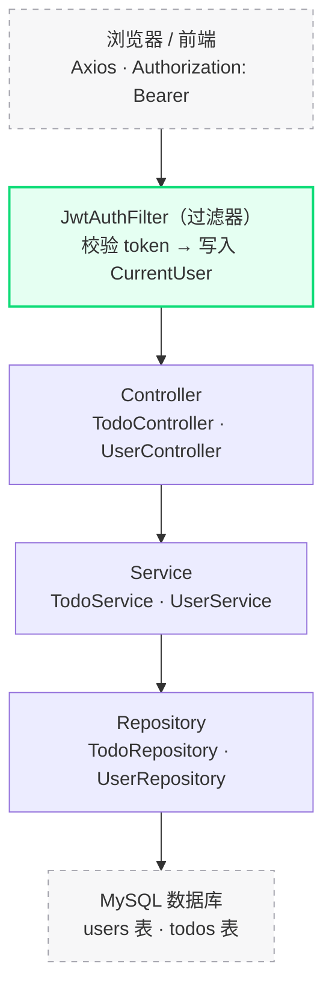
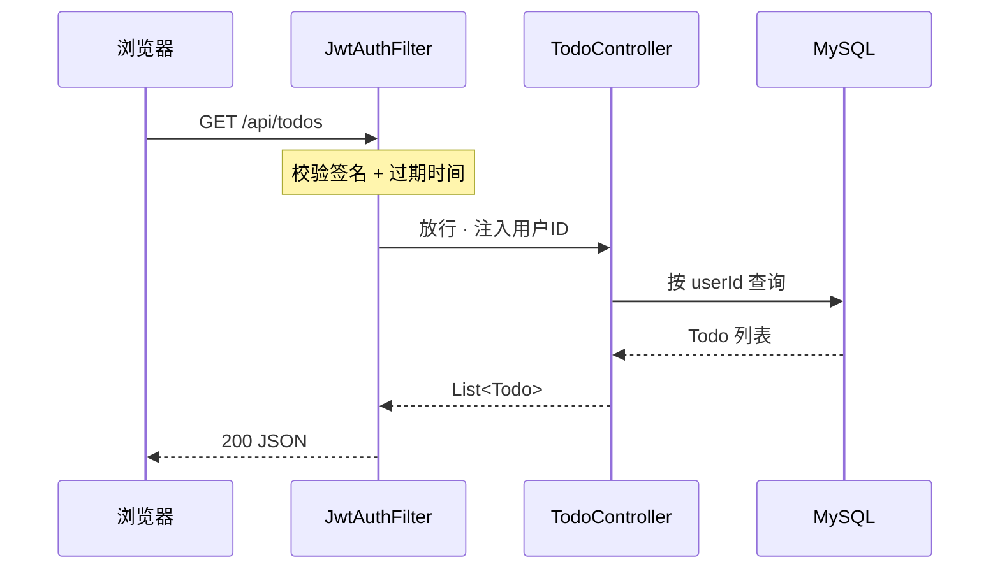
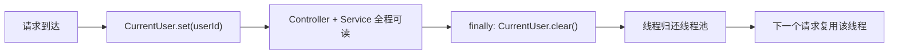

# Todo 后端项目详解（费曼式讲解）

> 面向只学过前端的同学，用类比 + 专业术语讲清这个 Spring Boot 后端项目。
> 项目路径：`d:\Aproject\practice\todo-app\todo-backend`
> 技术栈：Java 17 + Spring Boot 3.3.4 + Spring Data JPA + MySQL + JWT

---

## 目录

0. [前置知识：Java 基础语法速成](#零前置知识java-基础语法速成给前端人)
1. [先建一个心智模型：后端是一家餐厅](#一先建一个心智模型后端是一家餐厅)
2. [项目全景：这是什么技术栈](#二项目全景这是什么技术栈)
3. [文件地图：每个包是干什么的](#三文件地图每个包是干什么的)
4. [分层是怎么串起来的](#四分层是怎么串起来的)
5. [逐个文件精讲](#五逐个文件精讲)
6. [认证专题：Request 是怎么"认出你是谁"的](#六认证专题request-是怎么认出你是谁的)
7. [全局异常处理：一个"兜底"收银台](#七全局异常处理一个兜底收银台)
8. [配置与启动：程序的"开关面板"](#八配置与启动程序的开关面板)
9. [额外亮点：AI 模块](#九额外亮点ai-模块)
10. [给前端人的"心智转换表"](#十给前端人的心智转换表)
11. [建议的动手顺序](#十一建议的动手顺序)

---

## 零、前置知识：Java 基础语法速成

> 这一章是为"只写过前端"的你准备的。项目里出现的**每一个 Java 语法点**，都先在这里讲一遍。已经会 Java 的话可以直接跳到第一章。
>
> 每一节的讲法是固定的四步：**它是什么 → 代码长什么样 → 前端类比是什么 → 本项目哪里用到它**。

### 0.1 一个文件 = 一个类

Java 是**纯面向对象**的语言，**所有代码都必须写在类里面**。你不可能像 JS 那样写一个"游离的函数"。

```java
public class UserService {          // 一个类
    public void login() { }         // 方法必须写在类里面
}
```

规则：如果类是 `public` 的，**文件名必须和类名完全一致**。`UserService` 类必须放在 `UserService.java` 里——这就是为什么你看到每个文件名都恰好等于里面的类名。

> **前端类比**：JS 可以有一个孤零零的 `function`，Java 不行；JS 一个文件可以导出很多东西，Java 的 `public class X` 必须"一名一体"（`X` 只能放在 `X.java`）。

### 0.2 包（package）与导入（import）

```java
package com.todo.service;          // ① 我在哪：声明当前文件属于哪个"包"
                                    //   （这一行必须是文件的第一行代码）
import com.todo.entity.User;       // ② 我用谁：把别的类登记进来
```

**`package` 是什么？** 是这个文件的"门牌号"。
`com.todo.service` 对应磁盘目录 `src/main/java/com/todo/service/`。加上包名后，类的"**全限定名**"就是 `com.todo.service.UserService`——全世界唯一，不会和别人重名。

命名规则是"**域名倒着写**"：

```
com.todo             → 这个项目（todo 应用）
org.springframework  → 框架作者（springframework.org 倒过来）
```

**`import` 是什么？** 把要用的"外部"类先登记进来，不登记编译器就报"找不到符号"。几乎等同于 JS 的 `import`，但 Java 更严格、必须写。

> **唯一例外**：`java.lang` 包（`String`、`Long`、`System`、`Exception` 这些最基础的类）由编译器**自动导入**，所以你看不到 `import java.lang.String`。

> **前端类比**：`package` ≈ 文件所在的文件夹路径；`import` ≈ ES Module 的 `import`。

### 0.3 类、对象、字段、方法

```java
public class Todo {                              // 类 = 图纸 / 模板
    private String title;                        // 字段（field）= 数据
    public String getTitle() { return title; }   // 方法（method）= 行为
}

Todo t = new Todo();                             // new 出"对象"（实例）= 按图纸造的实物
t.setTitle("买牛奶");
```

| Java 术语 | 含义 | 前端叫法 |
|-----------|------|---------|
| 类（class） | 图纸，描述"这类东西有什么" | `class` |
| 对象（object / instance） | 按图纸造出来的具体东西 | 实例 |
| 字段（field） | 类里的变量，用来存数据 | 属性 / property |
| 方法（method） | 类里的函数，用来做事 | 方法 / 函数 |
| `this` | "当前这个对象自己" | `this` |

`this` 最常用的场景是**区分同名的字段和参数**：

```java
public void setTitle(String title) {
    this.title = title;      // 左边的 this.title 是字段，右边的 title 是参数
}
```

还有一种"只用来装数据"的简写类，本项目也用到了：

```java
// record：Java 16+ 的语法糖，专门定义"只装数据"的小类
record Scored(Todo todo, double score) {}
// 一行等于传统写法的一堆 getter / 构造器 / equals / hashCode
```

> **前端类比**：类 ≈ ES6 `class`；对象 ≈ `new` 出来的实例；字段 ≈ 实例属性；方法 ≈ 实例方法。这一节几乎和 JS 一模一样，最好懂。

### 0.4 访问修饰符 + final（控制"谁能看见"）

| 修饰符 | 谁能访问 | 前端类比 |
|--------|---------|---------|
| `public` | 任何地方都能访问 | 公开导出 |
| `protected` | 同一个包 + 子类 | 受保护 |
| （什么都不写） | 只限同一个包 | 包内可见 |
| `private` | 只有本类内部 | `#privateField` |

```java
private final UserRepository userRepository;
```

- `private`：字段只给自己类用，外部必须通过方法访问——这叫**封装（Encapsulation）**。你在 Entity 里看到的一大堆 `getXxx/setXxx`，就是为了让外部"通过门进房间"。
- `final`：**一旦赋值就不能再改**。用在字段上 = "这个引用永远指向同一个对象"；用在类上（如 `CurrentUser`）= "这个类不允许被继承"。

> **前端类比**：`final` ≈ `const`。区别是 Java 的 `final` 只管"引用不能换"，对象内部的属性还是可以改的。

### 0.5 类型系统：基本类型 vs 引用类型

Java 是**强类型 + 静态类型**语言：每个变量必须先声明类型，且不能随便换（JS 的"变量可以是任何东西"在 Java 里不存在）。

- **8 种基本类型**（变量里直接存"值"）：`byte` `short` `int` `long` `float` `double` `boolean` `char`
- **引用类型**（变量里存"地址"，指向一个对象）：`String`、数组、所有类、所有接口、`List`、`Map`……

```java
int count = 10;          // 基本类型：直接存 10
Long id = 1L;            // 引用类型：Long 是个类；1L 表示 64 位整数
String name = "alice";   // 引用类型
boolean done = false;    // 基本类型
```

**一个真实的细节**：本项目主键用 `Long` 而不是 `long`。因为 JPA 需要"对象类型"才能表达"**还没有值**"（`null`）——基本类型 `long` 永远是 0，不能是 null。

**自动装箱 / 拆箱（Autoboxing）**：`Long ↔ long` 之间 Java 会自动转换，所以你写 `user.getId()`（返回 `Long`）可以直接当数字用。

> **前端类比**：`int`/`double` ↔ TS 的 `number`；`boolean` ↔ `boolean`；`char` ↔ 单个字符。最大差异是 **Java 的 `String` 是引用类型**（它是个类，首字母大写），而 TS 的 `string` 是原始类型。

### 0.6 泛型（Generics）：尖括号 `< >`

```java
List<Todo> todos;                        // 一个"只能装 Todo"的列表
JpaRepository<User, Long> repository;    // 操作 User 实体，主键类型是 Long
Optional<User> found;                    // 里面可能有 User，也可能没有
Map<String, String> response;            // key 是 String，value 是 String
```

尖括号里写的是**类型参数**——"把类型当作参数传递"。写成 `List<Todo>` 后，往里塞 `String` 编译器**当场报错**。两个好处：① 编译期就拦住类型错误；② 取出来时不用手动强转类型。

自己定义泛型：`class Box<T> { T value; }`，用的时候 `new Box<Todo>()`。

> **前端类比**：就是 TS 的 `Array<Todo>`、`Promise<User>`。唯一区别：Java 泛型在运行时会被**擦除（erasure）**——运行时 JVM 分不清 `List<Todo>` 和 `List<String>`，它俩在底层都是 `List`。

### 0.7 接口与实现：interface / implements / extends

```java
// 接口：只声明"能做什么"，不写"怎么做"（方法没有方法体）
public interface UserRepository extends JpaRepository<User, Long> {
    Optional<User> findByUsername(String username);
}

// 类：可以继承一个类、实现多个接口
public class JwtAuthFilter extends OncePerRequestFilter {
    @Override
    protected void doFilterInternal(...) { ... }   // 覆写父类的方法
}
```

| 关键字 | 含义 | 一句话 |
|--------|------|-------|
| `interface` | 契约 / 规范，只声明不实现 | "能做什么" |
| `implements` | 类去实现接口 | "承诺遵守契约" |
| `extends` | 继承（类单继承，接口可多继承） | "我是它的子类" |
| `@Override` | 标注"我在覆写父类方法" | 写错了编译器会提醒 |

本项目里 [JwtAuthFilter](file:///d:/Aproject/practice/todo-app/todo-backend/src/main/java/com/todo/auth/JwtAuthFilter.java) `extends OncePerRequestFilter`（继承 Spring 的过滤基类），[UserRepository](file:///d:/Aproject/practice/todo-app/todo-backend/src/main/java/com/todo/repository/UserRepository.java) `extends JpaRepository`（继承数据访问接口，白送一堆方法）。

> **前端类比**：`interface` 和 TS 的 `interface` 是同一个意思；`extends` ≈ 类继承；`implements` ≈ `class X implements Y`（TS 里也有）。

### 0.8 注解（Annotation）：`@` 符号

```java
@Service                       // 告诉 Spring：这个类归你管
@RequestMapping("/api/todos")  // 告诉 Spring：这个类的 URL 前缀
public class TodoController {
    @GetMapping                // 这个方法是处理 GET 请求的
    public List<Todo> list() { ... }
}
```

**注解本身不执行任何逻辑**，它只是"贴在代码上的标签"。真正干活的是框架：Spring 启动时扫描这些标签，然后做对应的事（创建对象、注册路由、建表……）。

常见注解分三类：

- **分层标记**：`@RestController` / `@Service` / `@Repository` / `@Component`
- **配置绑定**：`@Configuration` / `@Bean`
- **行为指令**：`@Override` / `@Valid` / `@Transactional`

> **前端类比**：和"装饰器（Decorator）"最接近。React 里没有，但 NestJS 的 `@Controller()`、`@Get()` 就是同一套思路（Nest 本身就是照着 Spring 设计的）。

### 0.9 异常：throw / try-catch-finally

```java
// 抛：发现问题就 throw，不用层层往上 return 错误码
if (exists) throw new IllegalArgumentException("Username already exists");

// 接：try 放可能出错的代码，catch 捕获，finally 无论如何都执行
try {
    Long userId = jwtUtil.parseUserId(token);
} catch (Exception e) {
    response.sendError(401);       // 出错时走这里
} finally {
    CurrentUser.clear();           // 不管成功失败都执行（清理资源）
}
```

- **异常（Exception）** 是 Java 的错误传递机制。
- `throw` 主动抛出，`catch` 捕获处理，`finally` 无论如何都执行（本项目用它清空 ThreadLocal）。
- **受检异常 vs 非受检异常**：`RuntimeException` 及其子类是"非受检"（unchecked），可以随便 throw；其它受检异常必须在方法签名上写 `throws xxx` 声明。本项目抛的 `IllegalArgumentException` 属于非受检，所以不用声明。

> **前端类比**：`try / catch / finally` 和 JS **完全一样**。区别是 Java 多了"受检异常"这个概念——编译器会强制你处理某些异常，JS 没有这种约束。

### 0.10 Lambda 表达式与方法引用

```java
// Lambda：把"一小段逻辑"当作参数传给方法
.orElseThrow(() -> new IllegalArgumentException("Invalid username or password"))

// 带参数的 Lambda
todos.stream().filter(t -> t.getTitle().contains(q))

// 方法引用：Lambda 的简写。Todo::getTitle 等价于 t -> t.getTitle()
.sorted(Comparator.comparingDouble(Scored::score))
```

Java 8 起支持 Lambda，前提是目标类型是**函数式接口**（只有一个抽象方法的接口）。本项目出现的 `Consumer<String>`（消费一个值、无返回）、`Supplier<T>`（无参数、返回一个值）都是函数式接口。

> **前端类比**：**和 JS 箭头函数几乎一模一样**。`() -> expr` ↔ `() => expr`；`a -> a + 1` ↔ `a => a + 1`；方法引用 `A::b` ↔ 直接把函数传进去。

### 0.11 Stream API：后端的"数组方法链"

这是本项目用得最多、前端人最该掌握的一块。

```java
return todos.stream()                       // ① 把集合变成"流"
        .filter(t -> t.isCompleted())       // ② 过滤
        .map(Todo::getTitle)                // ③ 映射：Todo → String
        .sorted()                           // ④ 排序
        .toList();                          // ⑤ 收集成 List（终端操作）
```

对照 JS：

| Java Stream | JavaScript |
|-------------|-----------|
| `.stream()` | 数组本身就能链式调用 |
| `.filter(t -> ...)` | `.filter(t => ...)` |
| `.map(Todo::getTitle)` | `.map(t => t.title)` |
| `.sorted(...)` | `.sort(...)` |
| `.limit(20)` | `.slice(0, 20)` |
| `.anyMatch(...)` | `.some(...)` |
| `.count()` | `.length` |
| `.toList()` | （filter/map 已有返回值） |

**一个重要差异**：Stream 是**惰性（lazy）**的——`.filter().map()` 只是"记下要做什么"，直到遇到 `.toList()` 这类**终端操作（terminal operation）**才真正开始跑。所以每个 Stream 链**最后必须有一个终端操作**，否则什么都不会发生。

> 本项目出现的地方：`TodoService` 的批量创建、`AiController` 的语义搜索打分排序、`GlobalExceptionHandler` 取第一个校验错误、`TodoService` 的归属校验 `.filter(...)`。

### 0.12 常用集合：List / Map / Set

```java
List<Todo> list = new ArrayList<>();     // 有序、可重复、有下标  → JS 数组
Map<String, String> m = new HashMap<>(); // 键值对               → JS 对象 / Map
Set<String> s = new HashSet<>();         // 元素不重复           → JS Set

// 快速创建"不可变集合"（Java 9+）
List.of("/api/register", "/api/login");
Map.of("message", "registered");
```

注意：`List.of()` / `Map.of()` 造出来的是**不可变集合**，往里 `add` 会直接抛异常。它们适合"定义常量"，本项目 `JwtAuthFilter.PUBLIC_PATHS` 就是这么写的。

> **前端类比**：`List` ↔ 数组；`Map` ↔ JS 对象或 `Map`；`Set` ↔ `Set`。

### 0.13 Optional：代替 null 的安全容器

```java
Optional<User> user = userRepository.findByUsername("alice");

user.orElseThrow(() -> new IllegalArgumentException("not found"));  // 没有就抛异常
user.orElse(null);                                                  // 没有就给默认值
user.isPresent();                                                   // 有没有值
user.map(User::getEmail);                                           // 有值才继续映射
```

**为什么需要它？** Java 里的 `null` 被称为"十亿美元的错误"——忘了判空就 `NullPointerException` 直接崩溃。`Optional<T>` 显式表达"这里可能有值，也可能没有"，**逼你在写代码时就处理"没有"的分支**。

> **前端类比**：像处理 `undefined` 的可选链 `?.`——区别是 Optional 是个真实的**容器对象**，不是语法糖；你必须先"打开容器"才能拿到里面的值。

### 0.14 static 与构造器

```java
// static：属于"类"本身，不属于某个对象，用类名直接调用，不用 new
public static final List<String> PUBLIC_PATHS = List.of("/api/register", "/api/login");
CurrentUser.set(userId);      // CurrentUser 里全是静态方法，从没 new 过

// 构造器（Constructor）：与类同名、没有返回类型，new 的时候自动执行
public UserService(UserRepository userRepository, PasswordEncoder passwordEncoder) {
    this.userRepository = userRepository;   // 把外面传进来的依赖存为自己的字段
}
```

- **static 成员**：属于类本身。静态方法里**不能**访问非静态的实例字段（因为那时对象可能还不存在）。
- **构造器**：对象诞生时执行的初始化代码。本项目用它做**构造器注入**——只声明"我需要哪些依赖"，Spring 负责把它们传进来（这就是第五章会讲的依赖注入）。

> **前端类比**：`static` ≈ 挂在类上的静态方法（如 `Array.isArray`）；构造器 ≈ `constructor()`。

### 0.15 语法速查对照表

| Java 语法 | 一句话理解 | 前端对应 |
|-----------|-----------|---------|
| `class` | 图纸 / 模板 | `class` |
| `new X()` | 按图纸造对象 | `new X()` |
| `this.x` | 当前对象自己的字段 | `this.x` |
| `package` | 文件的门牌号 | 文件夹路径 |
| `import` | 登记要用的外部类 | `import` |
| `public` / `private` | 可见范围 | `export` / `#private` |
| `final` | 赋值后不可改 | `const` |
| `int` / `Long` / `String` | 类型声明 | TS 类型标注 |
| `<T>` 泛型 | 把类型当参数传 | TS 泛型 |
| `interface` / `implements` | 契约 / 遵守契约 | TS `interface` / `implements` |
| `extends` | 继承 | `extends` |
| `@Service` 等注解 | 贴标签，框架读取后干活 | 装饰器 |
| `throw` / `try-catch` | 抛异常 / 接异常 | `throw` / `try-catch` |
| `finally` | 无论如何都执行 | `finally` |
| `->` Lambda | 匿名小函数 | `=>` 箭头函数 |
| `A::b` 方法引用 | Lambda 的简写 | 直接传函数引用 |
| `.stream().filter().map()` | 集合处理链（惰性） | 数组的 `.filter().map()` |
| `Optional<T>` | 可能为空的容器 | 可选链 `?.` |
| `static` | 属于类，不属于对象 | 静态方法 |
| `record` | 只装数据的简写类 | TS 的只读 `type` |

---

## 一、先建一个心智模型：后端是一家餐厅

前端做的事是：**把数据画到屏幕上，把用户操作收集起来**。但数据从哪来？谁保存的？谁保证"张三看不到李四的待办"？——这就是后端。

用餐厅类比：

| 餐厅 | 后端 | 对应文件 |
|------|------|----------|
| 顾客点单 | 前端发 HTTP 请求 | Axios（前端） |
| 门口保安检查会员卡 | 校验 JWT Token | `auth/JwtAuthFilter.java` |
| 服务员接单、安排流程 | 接收请求、组织业务 | `controller/TodoController.java` |
| 后厨按菜谱做菜 | 业务规则、校验、判断 | `service/TodoService.java` |
| 仓库管理员存取食材 | 读写数据库 | `repository/TodoRepository.java` |
| 冷库 | MySQL 数据库 | `todo_db` |
| 菜单模板 | 数据表结构 | `schema.sql` |

这个类比的核心是**分层**：每一层只跟相邻的一层说话。服务员不会自己跑进冷库拿菜，后厨也不会直接跟顾客对账。这就是后端最重要的架构思想——**Controller → Service → Repository → Database**。

---

## 二、项目全景：这是什么技术栈

打开 `pom.xml`（Maven 的"配置文件"，相当于前端的 `package.json`），每个 `<dependency>` 就是一个"库"：

| 依赖 | 作用 | 前端类比 |
|------|------|----------|
| `spring-boot-starter-web` | 起一个 HTTP 服务器，提供 `@RestController` 等注解 | Express / Koa |
| `spring-boot-starter-data-jpa` | ORM 框架，用 Java 对象操作数据库表 | Prisma / TypeORM |
| `spring-boot-starter-validation` | 参数校验，`@NotBlank`、`@Size` 就是它 | zod / yup |
| `spring-security-crypto` | 只取了密码加密（BCrypt）这一个零件 | bcrypt 库 |
| `mysql-connector-j` | Java 连接 MySQL 的驱动 | mysql2 |
| `jjwt-*`（三件套） | 生成和解析 JWT Token | jsonwebtoken |

> 注意一个细节：它用的是 `spring-security-crypto` 而不是完整的 `spring-security`。作者只要了"密码加密"这一个能力，没要整套安全框架，认证是**自己写 Filter 实现**的。这是个很清醒的取舍，也是值得重点学的部分。

**整个程序的入口只有一个方法**，在 `TodoApplication.java`：

```java
@SpringBootApplication          // 一个注解 = 开启自动装配 + 组件扫描
public class TodoApplication {
    public static void main(String[] args) {
        SpringApplication.run(TodoApplication.class, args);   // 启动内嵌 Tomcat
    }
}
```

这三行是整个后端的"点火开关"。`@SpringBootApplication` 会让 Spring 去扫描 `com.todo` 包及子包下所有带 `@Component`/`@Service`/`@Repository`/`@Controller` 的类，**自动 new 出对象并管起来**（这叫 IoC 容器 / 依赖注入）。你在代码里从没看到 `new TodoService()`，但处处能用它——这是后端和前端差异最大的一个观念。

---

## 三、文件地图：每个包是干什么的

```
src/main/java/com/todo/
├── TodoApplication.java     ← 入口（main 方法）
├── entity/                  ← 数据表的"Java 镜像"
│   ├── User.java            ← 映射 users 表
│   └── Todo.java            ← 映射 todos 表
├── repository/              ← 数据访问层（只写接口！）
│   ├── UserRepository.java
│   └── TodoRepository.java
├── dto/                     ← 前后端之间的"传输快递盒"
│   ├── UserDTO.java
│   └── TodoDTO.java
├── service/                 ← 业务逻辑层
│   ├── UserService.java     ← 注册 / 登录
│   ├── TodoService.java     ← 增删改查待办
│   └── AiService.java       ← 调大模型（额外亮点）
├── controller/              ← 接口层（对外暴露 URL）
│   ├── UserController.java  ← /api/register, /api/login
│   ├── TodoController.java  ← /api/todos
│   ├── UploadController.java← /api/uploads
│   └── AiController.java    ← /api/ai/*
├── auth/                    ← 认证三件套
│   ├── JwtUtil.java         ← 签发 / 解析 token
│   ├── JwtAuthFilter.java   ← 拦截每个请求查验 token
│   └── CurrentUser.java     ← 让"当前用户"在本次请求中随处可用
├── config/SecurityConfig.java ← 全局配置（跨域、静态资源、过滤器注册）
└── exception/GlobalExceptionHandler.java ← 全局错误兜底
```

一句话记忆：**entity 是"数据长什么样"，repository 是"怎么拿到数据"，dto 是"传输格式"，service 是"规则"，controller 是"入口"，auth 是"门禁"**。

---

## 四、分层是怎么串起来的

一个请求从上到下穿过每一层，每一层对应一个包：



再来看**一次 `GET /api/todos` 的完整链路**：



---

## 五、逐个文件精讲

### 5.1 Entity 层 —— 数据表的"Java 镜像"

`User.java` 和 `Todo.java` 是**纯数据类**，没有业务逻辑，只是把数据库表"翻译"成 Java 对象（这叫 **ORM**，对象关系映射）。

```java
@Entity                                  // 告诉 JPA：这是一个数据库表
@Table(name = "users", uniqueConstraints = @UniqueConstraint(columnNames = "username"))
public class User {
    @Id
    @GeneratedValue(strategy = GenerationType.IDENTITY)   // 自增主键
    private Long id;

    @Column(nullable = false, length = 50)   // 对应列：非空、varchar(50)
    private String username;
    // ...
}
```

对照 `schema.sql` 看，一一对应：

| 注解 | 生成的 SQL |
|------|-----------|
| `@Entity` + `@Table(name="users")` | `CREATE TABLE users` |
| `@Id` + `@GeneratedValue` | `id BIGINT AUTO_INCREMENT PRIMARY KEY` |
| `@Column(length = 50)` | `username VARCHAR(50)` |
| `@Column(columnDefinition = "TEXT")` | `description TEXT` |
| `@PreUpdate` | 每次 UPDATE 前自动刷新 `updated_at` |

`@PreUpdate` 是 Todo 里的一个小技巧：

```java
@PreUpdate
public void preUpdate() { this.updatedAt = LocalDateTime.now(); }
```

它是**钩子方法**，JPA 在真正执行 UPDATE 之前自动调用它，所以你永远不用手写"更新时间"这个字段——就像 Vue 的 `watch` 帮你自动同步派生状态。

还有一个**很有教学价值的细节**：Todo 里存的是 `private Long userId`，而不是 `@ManyToOne private User user`。这是作者刻意的简化——不建立对象关联，表里就是一个普通外键列。代价是查关联数据要自己查两次，好处是逻辑简单、不会被 JPA 的懒加载坑住。

### 5.2 Repository 层 —— 只写接口，不写实现

这是后端最"魔法"的地方：

```java
public interface UserRepository extends JpaRepository<User, Long> {
    Optional<User> findByUsername(String username);
    boolean existsByUsername(String username);
}
```

**整个文件没有一个 `{}` 方法体**，但它真的能查数据库。原理是：Spring Data JPA 在启动时扫描所有 Repository 接口，**根据方法名的命名规则自动生成实现类和 SQL**。

拆解 `findByUsername`：`find`（查）+ `By`（条件分隔符）+ `Username`（字段名）→ `SELECT * FROM users WHERE username = ?`。

再看 Todo 里那个超长方法名：

```java
List<Todo> findByUserIdAndCompletedOrderByCreatedAtDesc(Long userId, boolean completed);
```

拆成四段：

- `findBy` → SELECT
- `UserId And Completed` → `WHERE user_id = ? AND completed = ?`
- `OrderByCreatedAtDesc` → `ORDER BY created_at DESC`
- 返回 `List<Todo>`

另外 `JpaRepository<User, Long>` 里的两个泛型是"**操作哪个实体**"和"**主键类型**"。继承它就白送一批方法：`save()`、`findById()`、`delete()`、`findAll()`、`count()`……Service 里用的 `save()`、`findById()`、`delete()` 全都来自这里，一行都不用写。

> 前端类比：这就像写了一个"接口声明"，框架帮你生成了 axios 请求函数——你只描述"我要按什么条件查"，不描述"怎么发请求"。

`Optional<User>` 是 Java 的"可能为空"容器。前端你有 `undefined`，Java 里 `null` 到处乱飞很容易 `NullPointerException` 崩溃，所以约定俗成用 `Optional` 显式表达"这个查询可能查不到"。取用的时候必须 `.orElseThrow(...)` 或 `.orElse(...)` 显式处理——**编译器逼你面对"查不到"的情况**。

### 5.3 DTO 层 —— 前后端之间的"快递盒"

`UserDTO.java` 和 `TodoDTO.java` 长得像 Entity，但用途完全不同。**为什么要多一层？** 三个理由：

1. **安全**：`User` 实体里有 `password` 字段。如果直接用它接收/返回 HTTP 数据，**返回时可能把密码哈希吐给前端**。DTO 可以做裁剪。
2. **校验**：DTO 上挂着校验注解。

```java
@NotBlank                          // 不能为空、不能全是空格
@Size(min = 2, max = 50)           // 长度 2~50
private String username;
```

配合 Controller 上的 `@Valid`，Spring 会在进 Controller 方法*之前*自动校验。校验失败抛 `MethodArgumentNotValidException`，被全局异常处理器接住，返回 400。**你一行 if 校验代码都没写。**

3. **解耦**：数据库表结构变了，DTO 可以不变，前端无感。

> 前端类比：DTO ≈ TypeScript 的 `type LoginPayload = { username: string; password: string }` + zod 的校验规则，二合一。

### 5.4 Service 层 —— 业务规则住在这里

`UserService.java` 是学"后端逻辑"最该细看的地方。注册：

```java
public void register(UserDTO dto) {
    if (userRepository.existsByUsername(dto.getUsername())) {
        throw new IllegalArgumentException("Username already exists");   // 业务异常
    }
    User user = new User();
    user.setUsername(dto.getUsername());
    user.setPassword(passwordEncoder.encode(dto.getPassword()));   // 关键：加密存储
    user.setEmail(dto.getEmail());
    userRepository.save(user);
}
```

这里有三件后端才关心的事：

- **唯一性检查**："用户名已存在"是业务规则，数据库虽然也有 UNIQUE 约束兜底，但主动检查能给出友好错误。
- **密码加密**：`passwordEncoder.encode()` 用的是 BCrypt，是**不可逆**的哈希。数据库里存的是 `$2a$10$xxxxx` 这种串，就算数据库被脱库，攻击者也拿不到明文密码。**永远不要存明文密码**，这是铁律。
- **异常即流程**：Java 后端习惯"发现问题就 throw"，而不是层层 `return null` 往上传递。异常会被集中处理。

登录：

```java
public String login(UserDTO dto) {
    User user = userRepository.findByUsername(dto.getUsername())
            .orElseThrow(() -> new IllegalArgumentException("Invalid username or password"));
    if (!passwordEncoder.matches(dto.getPassword(), user.getPassword())) {
        throw new IllegalArgumentException("Invalid username or password");
    }
    return jwtUtil.generate(user.getId(), user.getUsername());   // 签发 token
}
```

注意两个安全细节：

- `passwordEncoder.matches(明文, 哈希)` 是 BCrypt 提供的比对方法（哈希不可逆，只能"再算一遍比结果"）。
- **"用户名不存在"和"密码错误"返回的是同一句错误信息**。如果分开报错，攻击者就能靠错误信息枚举出哪些用户名真实存在。

再看 `TodoService.java`，这里有个**极重要的安全写法**：

```java
public Todo update(Long id, TodoDTO dto) {
    Todo todo = todoRepository.findById(id)
            .filter(t -> t.getUserId().equals(CurrentUser.get()))   // ← 归属校验
            .orElseThrow(() -> new ResponseStatusException(HttpStatus.NOT_FOUND, "Todo not found"));
    // ...
}
```

`.filter(...)` 这一行是**水平越权防护**。如果只写 `findById(id)`，那用户 A 拿着 URL `/api/todos/99` 就能改用户 B 的第 99 条待办——因为 Java 根本不知道"这个 id 归谁"。加上 `.filter()` 后，只有 `todo.userId` 等于"当前登录用户 id"才放行。

而且注意它抛的是 **404 而不是 403**（拒绝访问）。为什么？403 等于告诉攻击者"这条数据存在，只是你没权限"，这本身就是信息泄露。404 让"不存在"和"不是你的"长得一模一样。这个细节很多工作三年的人都写不对。

`list()` 里也贯彻了同样的原则——**永远不查"所有待办"，只查"我的待办"**：

```java
public List<Todo> list(Boolean completed) {
    Long userId = CurrentUser.get();     // 从 ThreadLocal 拿当前用户
    if (completed == null) {
        return todoRepository.findByUserIdOrderByCreatedAtDesc(userId);
    }
    return todoRepository.findByUserIdAndCompletedOrderByCreatedAtDesc(userId, completed);
}
```

### 5.5 Controller 层 —— 对外的门牌号

`TodoController.java` 极薄，几乎只做"转发"：

```java
@RestController                    // = @Controller + @ResponseBody（返回值自动转 JSON）
@RequestMapping("/api/todos")      // 类级别的前缀
public class TodoController {

    @GetMapping                                            // GET /api/todos
    public List<Todo> list(@RequestParam(required = false) Boolean completed) {
        return todoService.list(completed);
    }

    @PostMapping                                           // POST /api/todos
    public Todo create(@Valid @RequestBody TodoDTO dto) {
        return todoService.create(dto);
    }

    @PutMapping("/{id}")                                   // PUT /api/todos/3
    public Todo update(@PathVariable Long id, @Valid @RequestBody TodoDTO dto) {
        return todoService.update(id, dto);
    }

    @DeleteMapping("/{id}")                                // DELETE /api/todos/3
    public ResponseEntity<Void> delete(@PathVariable Long id) {
        todoService.delete(id);
        return ResponseEntity.noContent().build();          // 204 No Content
    }
}
```

注解对照表（写 RESTful 接口会一直用）：

| 注解 | 含义 | 数据从哪来 |
|------|------|-----------|
| `@GetMapping` / `@PostMapping` / `@PutMapping` / `@DeleteMapping` | HTTP 方法 | — |
| `@PathVariable` | 路径参数 | `/api/todos/{id}` 里的 `{id}` |
| `@RequestParam` | 查询参数 | `/api/todos?completed=true` |
| `@RequestBody` | 请求体 | POST/PUT 的 JSON body |
| `@Valid` | 触发 DTO 校验 | — |
| `@RequestPart("file")` | 文件上传 | `multipart/form-data` |

**"Controller 薄、Service 厚"是后端公认的好架构**：Controller 只管 HTTP 语义（路径、状态码、参数绑定），Service 管业务规则。这样将来如果要把项目从 Web 改成定时任务，Service 一行不用改。

---

## 六、认证专题：Request 是怎么"认出你是谁"的

HTTP 是**无状态**的——服务器天生不记得"你刚刚登录过"。JWT 就是解决这个的方案。

### 第 1 步：登录时签发一张"身份证"—— `JwtUtil.java`

```java
public String generate(Long userId, String username) {
    return Jwts.builder()
            .setSubject(String.valueOf(userId))                              // 载荷：userId
            .claim("username", username)                                     // 载荷：用户名
            .setIssuedAt(new Date())                                         // 签发时间
            .setExpiration(new Date(System.currentTimeMillis() + expireMs))  // 过期时间（24h）
            .signWith(key, SignatureAlgorithm.HS256)                         // 用密钥签名
            .compact();
}
```

一个 JWT 长得像 `xxxxx.yyyyy.zzzzz`，三段用 `.` 分隔：

1. **Header**：算法是什么（HS256）
2. **Payload**：里面装的数据（userId、username、过期时间）——**注意：这段是 Base64 编码，不是加密，任何人都能解开看！** 所以 JWT 里绝对不能放密码。
3. **Signature**：用服务器密钥对前两段做签名。

**为什么篡改不了？** 如果攻击者把 payload 改成 `userId: 999`，他算不出对应的签名（因为他没有密钥）。服务器验签时对不上，直接拒绝。这就是 JWT 的安全根基：**内容公开，但不可伪造**。

密钥从哪来？`application.yml`：

```yaml
jwt:
  secret: ${JWT_SECRET:change-me-please-32-bytes-min-secret-key!!}
  expire-ms: 86400000    # 24 小时
```

`${JWT_SECRET:默认值}` 是 Spring 的语法：优先读环境变量 `JWT_SECRET`，读不到才用默认值。**这是生产环境的安全实践**——密钥不进代码仓库，通过环境变量注入。

### 第 2 步：每个请求都验身份证 —— `JwtAuthFilter.java`

**Filter（过滤器）** 是 Servlet 世界的概念，可以理解为"进入 Controller 之前的一道安检门"。所有请求都要经过它：

```java
public static final List<String> PUBLIC_PATHS = List.of("/api/register", "/api/login");

@Override
protected boolean shouldNotFilter(HttpServletRequest request) {
    return PUBLIC_PATHS.contains(request.getServletPath());   // 注册和登录不用查卡
}

@Override
protected void doFilterInternal(...) {
    String header = request.getHeader("Authorization");
    if (header == null || !header.startsWith("Bearer ")) {
        response.sendError(401, "Missing token");       // 没带卡 → 401
        return;                                          // return 就是"到此为止"，不放行
    }
    try {
        Long userId = jwtUtil.parseUserId(header.substring(7));   // 砍掉"Bearer "前缀再解析
        CurrentUser.set(userId);                                  // 存进"本次请求的临时口袋"
        chain.doFilter(request, response);                        // 放行！交给 Controller
    } catch (Exception e) {
        response.sendError(401, "Invalid token");                 // 卡是假的/过期了 → 401
    } finally {
        CurrentUser.clear();                                      // 无论如何都清空口袋
    }
}
```

三个关键设计：

- **白名单机制**：`shouldNotFilter` 让注册/登录跳过验证（否则你登录都要先登录，死循环）。
- **不调用 `chain.doFilter` 就是"拦截"**：这是 Filter 的标准拦截方式，比抛异常更干净。
- **`finally` 里清空**：无论成功失败都必须清，原因见下一步。

### 第 3 步：让"当前用户"随处可用 —— `CurrentUser.java`

```java
public final class CurrentUser {
    private static final ThreadLocal<Long> USER_ID = new ThreadLocal<>();
    public static void set(Long userId) { USER_ID.set(userId); }
    public static Long get() { return USER_ID.get(); }
    public static void clear() { USER_ID.remove(); }
}
```

只有 8 行，但它是整个认证链路的关键枢纽。核心是 **`ThreadLocal`**。

**ThreadLocal 是什么？** 可以理解成"**每个线程私有的储物柜**"。Tomcat 处理每个请求时会分配一个线程，`ThreadLocal` 让数据只属于当前线程，其他线程看不到。

**为什么要它？** 因为 `CurrentUser.get()` 让任何一层的代码都能拿到当前用户 id，**而不用把 `userId` 当参数一层层往下传**。如果不用 ThreadLocal，你的方法签名会变成：

```java
// 痛苦的写法
service.list(userId);
service.update(userId, id, dto);
repo.findByUserId(userId);      // 每一层都要多带一个参数
```

用 ThreadLocal 后，`TodoService` 里直接 `CurrentUser.get()`，方法签名干净了。

**代价是什么？** 线程是**复用**的！Tomcat 的线程池里线程处理完请求 A 后，会去处理请求 B。如果处理 A 时忘了 `clear()`，那处理 B 的时候 `CurrentUser.get()` 会读出**用户 A 的 id**——这是灾难级的安全漏洞（用户 B 会看到用户 A 的数据）。

所以 `JwtAuthFilter` 的 `finally { CurrentUser.clear(); }` **不是可选项，是必须项**。



### 第 4 步：过滤器怎么挂上去 —— `SecurityConfig.java`

```java
@Bean
public FilterRegistrationBean<JwtAuthFilter> jwtFilter(JwtAuthFilter filter) {
    FilterRegistrationBean<JwtAuthFilter> reg = new FilterRegistrationBean<>(filter);
    reg.addUrlPatterns("/api/*");    // 只拦 /api/ 开头的请求
    reg.setOrder(1);                 // 优先级
    return reg;
}
```

**`@Bean` 是什么？** 这是 Spring 依赖注入的核心注解。方法上标 `@Bean`，意思是"这个方法造出来的对象**由 Spring 容器接管**，之后任何地方需要它都能直接拿到"。传统 Java 你要 `new BCryptPasswordEncoder()`，有了 Spring，你只要声明一次 `@Bean`，其他地方直接**声明参数**就有：

```java
public UserService(UserRepository userRepository, PasswordEncoder passwordEncoder, JwtUtil jwtUtil) {
    // ↑ 这三个对象不是你 new 的，是 Spring 从容器里"塞"进来的（构造器注入）
}
```

这叫**控制反转（IoC）+ 依赖注入（DI）**——对象之间的装配交给框架，你只负责声明"我需要什么"。

> 前端类比：`@Bean` 有点像 React Context Provider 注册了一个值，子组件用 `useContext` 直接取，不用一层层 props 传递。

这个文件里还有两个配置值得看（都和前端直接相关）：

```java
// 跨域：前端 3000 端口调后端 8080 端口，浏览器会拦，必须后端开 CORS
registry.addMapping("/api/**")
        .allowedOrigins("*")
        .allowedMethods("GET", "POST", "PUT", "DELETE", "OPTIONS");

// 静态资源：让 /uploads/xxx.png 这个 URL 能直接读到磁盘文件
String dir = Path.of(System.getProperty("user.dir"), "uploads").toUri().toString();
if (!dir.endsWith("/")) dir += "/";    // ← 末尾斜杠必须有，否则文件名拼不上
registry.addResourceHandler("/uploads/**").addResourceLocations(dir);
```

那个**末尾斜杠**是踩过的坑：Spring 是直接字符串拼接 `location + 文件名`，少了斜杠就会拼成 `.../uploadsfilename.png`，图片 404。

---

## 七、全局异常处理：一个"兜底"收银台

`GlobalExceptionHandler.java` 让你**不用在每个 Controller 里写 try-catch**：

```java
@RestControllerAdvice                     // "我是全局异常处理器"
public class GlobalExceptionHandler {

    @ExceptionHandler(IllegalArgumentException.class)          // 业务异常 → 400
    public ResponseEntity<Map<String, String>> badRequest(IllegalArgumentException e) {
        return ResponseEntity.badRequest().body(Map.of("message", e.getMessage()));
    }

    @ExceptionHandler(MethodArgumentNotValidException.class)   // 校验失败 → 400
    public ResponseEntity<Map<String, String>> validation(MethodArgumentNotValidException e) {
        String msg = e.getBindingResult().getFieldErrors().stream()
                .map(f -> f.getField() + ": " + f.getDefaultMessage())
                .findFirst().orElse("Validation failed");
        return ResponseEntity.badRequest().body(Map.of("message", msg));
    }

    @ExceptionHandler(Exception.class)                         // 其它所有异常 → 500
    public ResponseEntity<Map<String, String>> generic(Exception e) {
        return ResponseEntity.status(HttpStatus.INTERNAL_SERVER_ERROR)
                .body(Map.of("message", "Internal error"));
    }
}
```

工作机制是 **AOP（面向切面编程）**：任何 Controller 抛出的异常都会被这里"截获"，而不是直接把 Java 堆栈暴露给前端。三层处理的设计很讲究：

| 异常类型 | HTTP 状态码 | 返回内容 | 前端怎么处理 |
|---------|------------|---------|------------|
| `IllegalArgumentException`（业务错误） | 400 | `{"message": "Username already exists"}` | 直接弹给用户看 |
| `MethodArgumentNotValidException`（参数校验） | 400 | `{"message": "username: 长度必须在2-50之间"}` | 直接弹给用户看 |
| `Exception`（意外错误） | 500 | `{"message": "Internal error"}` | 提示"服务器开小差了" |

注意 500 那层**故意不返回具体原因**——因为那是程序 bug，堆栈信息可能泄露表结构、文件路径等内部细节，所以统一返回模糊文案，真实原因记在服务器日志里。

这也是为什么前端代码里可以统一写：

```js
catch (e) {
  alert(e.response.data.message)   // 后端保证了"任何错误都有 message 字段"
}
```

**约定优于配置**——后端定好统一格式，前端不用为每个接口写不同的错误处理。这个 `{"message": "..."}` 的格式就是前后端的契约。

---

## 八、配置与启动：程序的"开关面板"

`application.yml` 是唯一的配置文件，几个关键板块：

```yaml
spring:
  servlet:
    multipart:
      max-file-size: 10MB          # 单文件上限
      max-request-size: 12MB       # 整个请求上限
  datasource:
    url: jdbc:mysql://localhost:3306/todo_db?...
    username: root
    password: "123456"
    driver-class-name: com.mysql.cj.jdbc.Driver
  jpa:
    hibernate:
      ddl-auto: update             # ← 关键配置，见下方
    show-sql: false                # 设为 true 就能在控制台看到每条 SQL

jwt:
  secret: ${JWT_SECRET:...}
  expire-ms: 86400000

server:
  port: 8080
```

**`ddl-auto: update` 是什么？** 它让 Hibernate 在启动时**自动比对 Entity 和数据库表结构**：表不存在就建，字段少了就加。所以你改 `Todo.java` 加个字段，重启后端，数据库自动多一列——开发期极其省事。

> ⚠️ 但**生产环境绝不能用 `update`**（更不能用 `create`，那会删表）。生产应该用 `validate` + 手写迁移脚本（Flyway / Liquibase）。这是新手常见的坑。

启动流程串起来：

```
mvn spring-boot:run
   ↓
TodoApplication.main() → SpringApplication.run()
   ↓
① 扫描 com.todo 包，把所有 @Service/@Repository/@RestController/@Component 实例化（IoC 容器）
   ↓
② 读取 application.yml，创建数据库连接池
   ↓
③ Hibernate 按 ddl-auto 检查/更新表结构
   ↓
④ 注册 JwtAuthFilter（addUrlPatterns("/api/*")）
   ↓
⑤ 内嵌 Tomcat 监听 8080 端口 → 可以接收请求了
```

**内嵌 Tomcat** 是个重要概念：以前 Java 部署要单独装 Tomcat 再把 war 包扔进去，Spring Boot 把 Tomcat 打包进了 jar，`main()` 一跑服务器就起来了。所以后端没有"安装服务器"这一步。

---

## 九、额外亮点：AI 模块

`AiService.java` 和 `AiController.java` 不是必修课，但**对学后端很有价值**，因为它示范了三件事：

### ① 优雅降级（Graceful Degradation）

```java
public boolean enabled() { return apiKey != null && !apiKey.isBlank(); }
public boolean semanticEnabled() { return enabled() && embedModel != null && !embedModel.isBlank(); }
```

没配 `AI_API_KEY` 时，AI 功能自动关闭，其他功能完全正常。搜索接口没 AI 就退化成**关键字匹配**：

```java
if (!ai.semanticEnabled()) {
    String lower = q.toLowerCase();
    return todos.stream()
            .filter(t -> (t.getTitle() + " " + t.getDescription()).toLowerCase().contains(lower))
            .toList();
}
```

配了 AI 就用**向量余弦相似度**做语义搜索。这种"**功能可选、核心不受影响**"的设计，是生产级后端的标配思路。

### ② 流式响应（SSE）

```java
SseEmitter emitter = new SseEmitter(120_000L);
new Thread(() -> {
    ai.chatStream(system, user, chunk -> emitter.send(...));   // 逐字推送
    emitter.send(mapper.writeValueAsString(Map.of("done", true)));
    emitter.complete();
}).start();
return emitter;
```

这里用 `SseEmitter` 做**服务器推送**，前端能看到 AI"打字机效果"——本质是 HTTP 长连接上服务器持续往下吐数据（ChatGPT 就是这么干的）。

### ③ 零依赖 HTTP 调用

```java
private final HttpClient http = HttpClient.newBuilder()...   // JDK 自带的 HTTP 客户端
```

它没有引入任何 AI SDK，直接用 JDK 自带的 `java.net.http.HttpClient` 发请求。符合"**能用标准库就用标准库**"的懒程序员哲学。

---

## 十、给前端人的"心智转换表"

最后把最关键的思维差异总结成一张对照表，以后看任何 Java 后端都能往这套上套：

| 概念 | 前端 | 后端（本项目） |
|------|------|--------------|
| 服务入口 | `main.tsx` / `index.js` | `TodoApplication.java` |
| 依赖管理 | `package.json` + `npm` | `pom.xml` + Maven |
| 配置文件 | `.env` / `vite.config.ts` | `application.yml` |
| 类型/数据校验 | TypeScript + zod | DTO + `@NotBlank`/`@Size` |
| "模块" | ES Module / 组件文件 | `@Service` 类（包 = 模块） |
| 依赖注入 | React Context / props 传递 | `@Bean` + 构造器注入（IoC 容器） |
| 中间件 | Express `app.use()` / axios 拦截器 | `Filter`（`JwtAuthFilter`） |
| 路由 | React Router / vue-router | `@RequestMapping` + `@GetMapping` |
| 全局错误处理 | `window.onerror` / axios 响应拦截器 | `@RestControllerAdvice` |
| 状态存储 | localStorage / Pinia | MySQL 数据库 |
| "跨请求的临时状态" | 组件内 state | `ThreadLocal`（`CurrentUser`） |
| 异步任务 | `setTimeout` / Web Worker | 新线程 / 线程池 |
| 认证 | localStorage 存 token | JWT + 过滤器 + 签名验真 |
| "查数据" | `fetch('/api/x')` | `repository.findByXxx()` 自动生成 SQL |

**如果只让你带走三个观念，是这三个：**

1. **分层是为了让每层只干一件事**。Controller 管 HTTP，Service 管业务，Repository 管数据。改需求时你能精确定位改哪个文件。
2. **安全不是"前端藏起来"，是"后端挡得住"**。前端任何校验都能被绕过（F12 就能改），所以密码要 BCrypt 加密、每个查询都要带 `userId` 过滤、`finally` 必须 `clear()`。这三条在本项目里都有具体代码。
3. **依赖注入是 Java 后端的"语法底色"**。看不到 `new`，到处都是构造器参数——理解这一点，Spring 的代码就突然能读了。

---

## 十一、建议的动手顺序

比只看更有用：

1. 把 `application.yml` 的 `show-sql` 改成 `true`，启动后调一次 `GET /api/todos`，亲眼看看自动生成的那条 SQL。
2. 跟着第六节把 `JwtAuthFilter` 的 `finally { CurrentUser.clear(); }` 注释掉，用两个账号交叉测试，**亲手制造一次越权**再改回来——这个实验能让你一辈子记住 ThreadLocal 的坑。
3. 给 Todo 加一个 `priority` 字段，走一遍"改 Entity → 改 DTO → 改 Service → 重启看数据库自动加列"的完整链路。

---

## 附：API 一览

| 方法 | 路径 | 说明 | 是否需要 token |
|------|------|------|--------------|
| POST | `/api/register` | 注册（username, password, email） | 否 |
| POST | `/api/login` | 登录，返回 JWT Token | 否 |
| GET | `/api/todos` | 查询任务列表（支持 `?completed=true/false` 筛选） | 是 |
| POST | `/api/todos` | 创建任务（归属当前用户） | 是 |
| POST | `/api/todos/batch` | 批量创建（供 AI 拆解流程使用） | 是 |
| PUT | `/api/todos/{id}` | 更新任务 | 是 |
| DELETE | `/api/todos/{id}` | 删除任务 | 是 |
| POST | `/api/uploads` | 上传图片（png/jpg/jpeg/gif/webp，≤10MB） | 是 |
| POST | `/api/ai/breakdown` | 目标拆解为子任务（SSE 流式） | 是 |
| POST | `/api/ai/parse` | 自然语言 → 结构化任务 | 是 |
| POST | `/api/ai/search` | 语义搜索待办 | 是 |

**测试账号**：用户名 `alice`，密码 `secret123`
**后端地址**：`http://localhost:8080`
